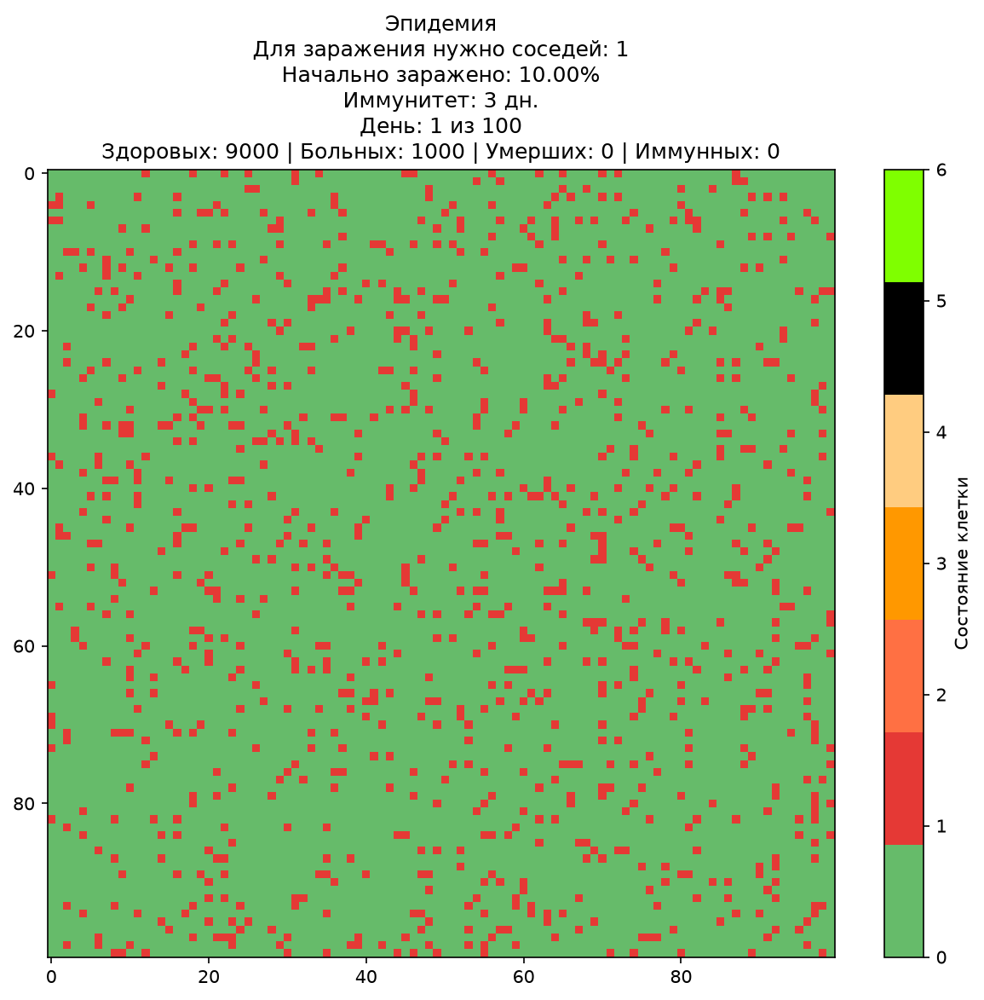
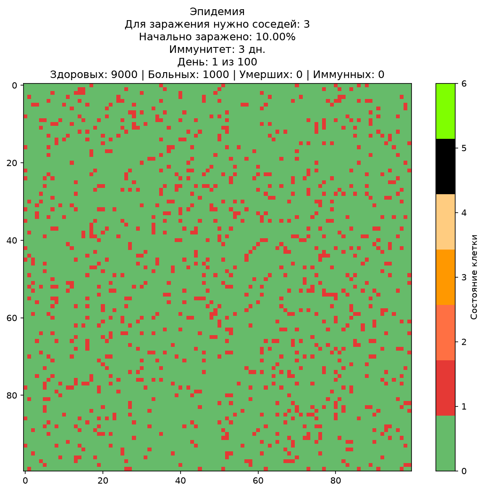
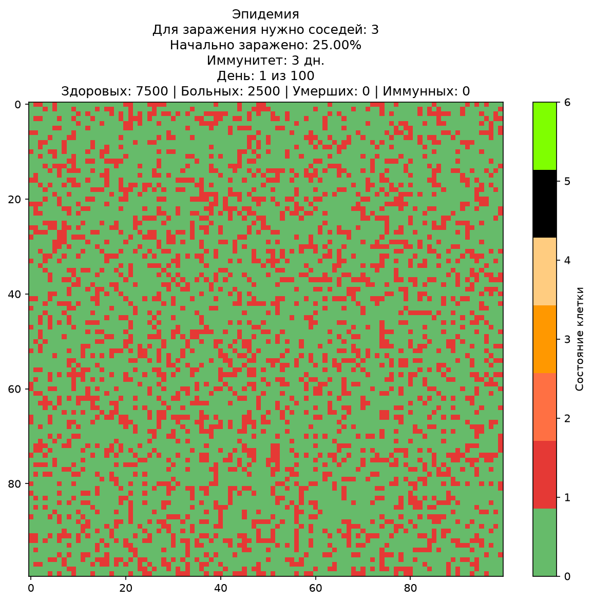
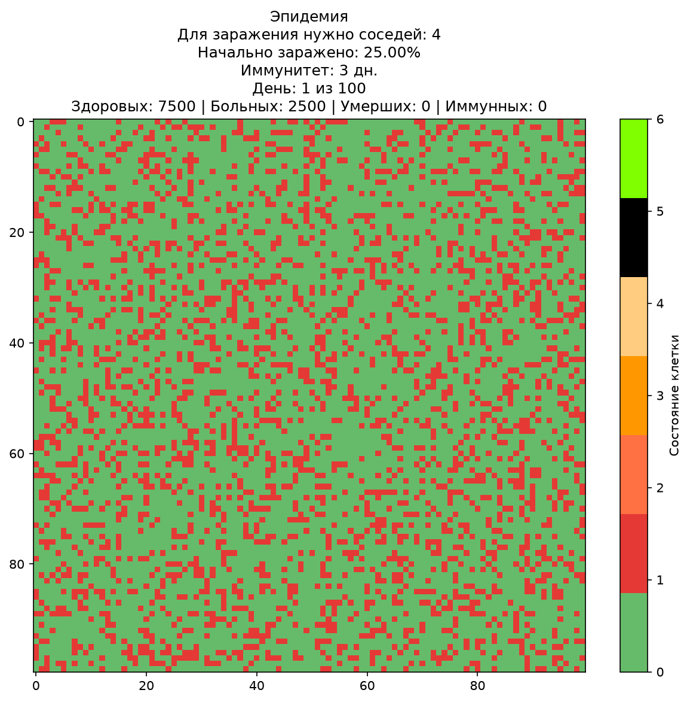
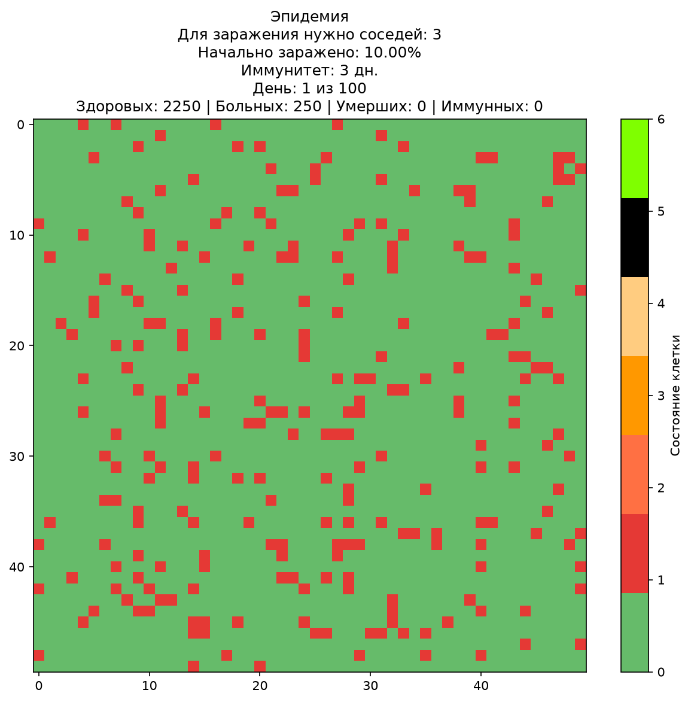
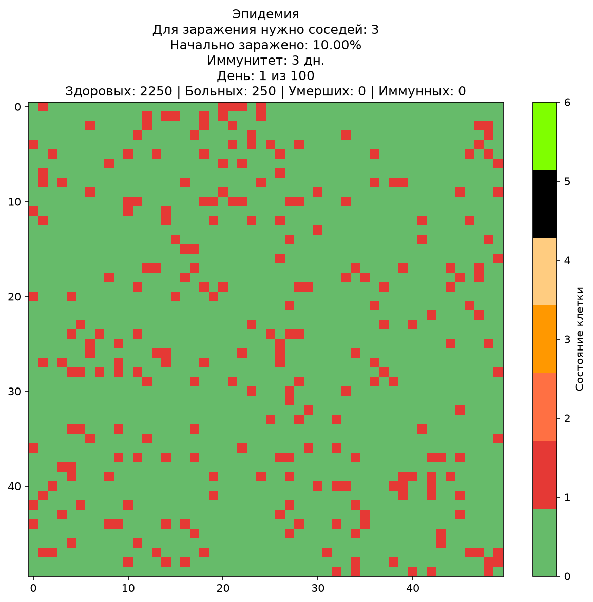
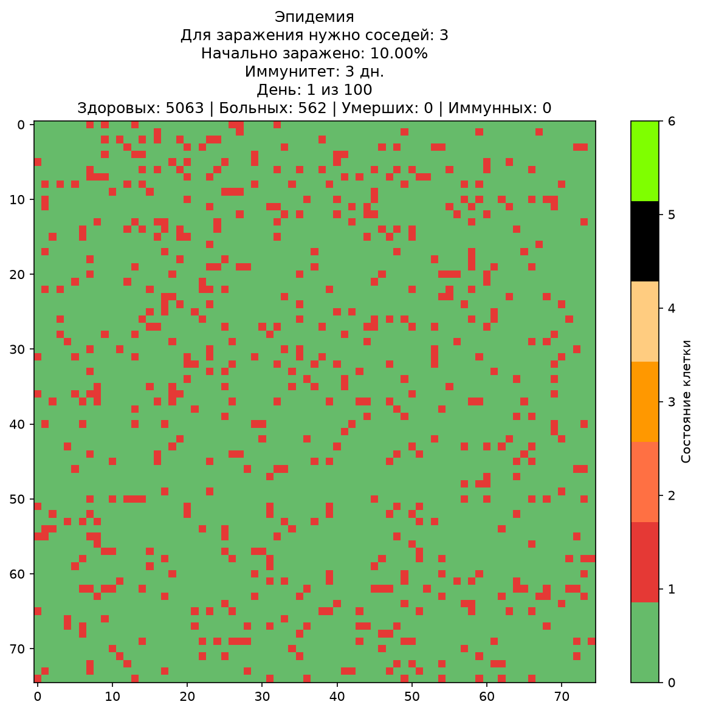
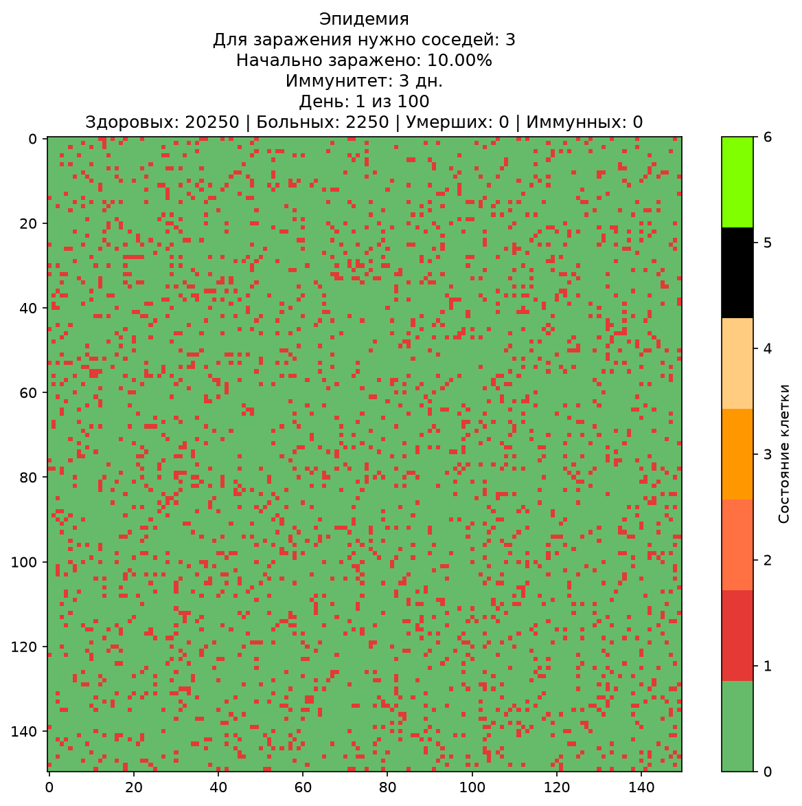
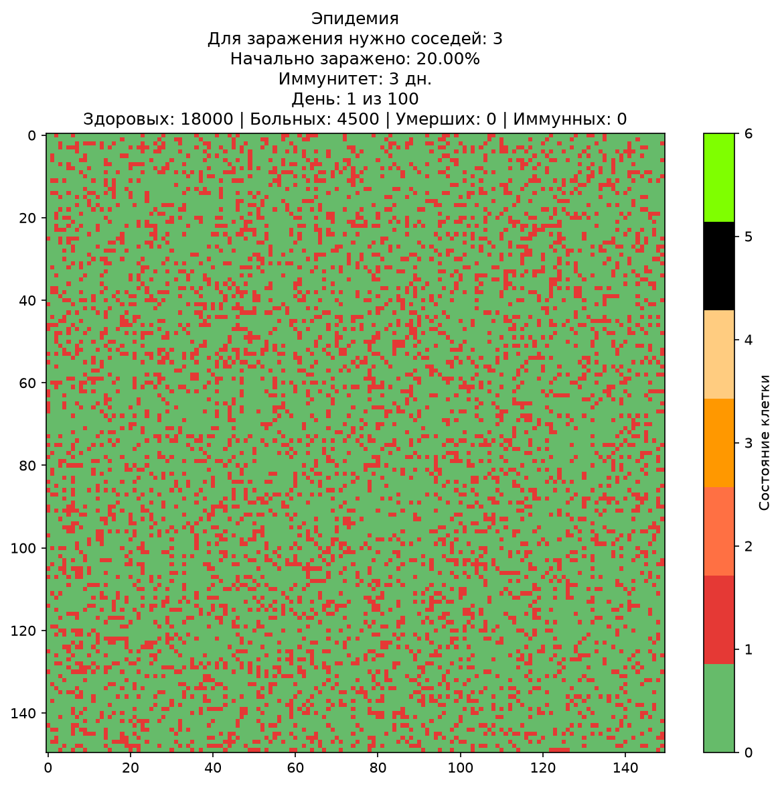

Прикреплённый .py файл представляет собой модель распространения эпидемии Гринберга-Гастингса. Модель способна имитировать распространение эпидемии на плоском поле с произвольными задаваемыми размерами. 
На поле обязательно присутствуют больные и здоровые клетки. В конце пользователь получает картину распространения эпидемии, а также количество и типы клеток.
--------------------------------------------------------------------------------------------------------------------------------------------------------------
Инструкция по запуску:
В начале выполнения кода появляется простейший интерфейс, в котором вводятся начальные данные (вид данных указан там же).
--------------------------------------------------------------------------------------------------------------------------------------------------------------
Структура данных: входные данные представляют собой последовательность чисел, ограниченных размеры области, количество больных клеток, смертность и скорость смены кадров в анимации.
Выходные данные представляют собой совокупность пошаговых отражений хода эпидемии, её gif-анимации и набора данных в консоли (разбивка по типам клеток).
--------------------------------------------------------------------------------------------------------------------------------------------------------------
Модель позволяет многократно проводить эксперименты с различными начальными данными в целях проверки работоспособности модели и установления интересующих фактов 
(влияние различных факторов на ход эпидемии и сравнение экспериментов между собой).
--------------------------------------------------------------------------------------------------------------------------------------------------------------
В отчёте каждый случай представлен соответствующим графиком состояния клеток. Здесь представлены gif-анимации, соответствующие каждому случаю.
Составные номера (например, "рисунок_8_1") означают, что анимация относится к 1-му подграфику случая 8.
--------------------------------------------------------------------------------------------------------------------------------------------------------------
<table>
  <!-- Строка 1 -->
  <tr>
    <td width="25%" align="center"> epidemic_pic1</td>
    <td width="25%" align="center"> epidemic_pic2</td>
    <td width="25%" align="center"> epidemic_pic3</td>
    <td width="25%" align="center"> epidemic_pic4</td>
  </tr>
  <!-- Строка 2 -->
  <tr>
    <td width="25%" align="center"> epidemic_pic5</td>
    <td width="25%" align="center"> epidemic_pic6</td>
    <td width="25%" align="center"> epidemic_pic7</td>
    <td width="25%" align="center"> epidemic_pic8_1</td>
  </tr>
  <!-- Строка 3 -->
  <tr>
    <td width="25%" align="center"> epidemic_pic8_2</td>
    <td width="25%" align="center"> epidemic_pic9</td>
    <td width="25%" align="center"> epidemic_pic10</td>
    <td width="25%" align="center"> epidemic_pic11</td>
  </tr>
  <!-- Строка 4 -->
  <tr>
    <td width="25%" align="center"> epidemic_pic12</td>
    <td width="25%" align="center"> epidemic_pic13</td>
    <td width="25%" align="center"> epidemic_pic14_1</td>
    <td width="25%" align="center"> epidemic_pic14_2</td>
  </tr>
  <!-- Строка 5 -->
  <tr>
    <td width="25%" align="center"> epidemic_pic15</td>
    <td width="25%" align="center"> epidemic_pic16</td>
    <td width="25%" align="center"> epidemic_pic17</td>
    <td width="25%" align="center"> epidemic_pic18</td>
  </tr>
  <!-- Строка 6 -->
  <tr>
    <td width="25%" align="center"> epidemic_pic19</td>
    <td width="25%" align="center"> epidemic_pic20</td>
    <td width="25%" align="center"> epidemic_pic21</td>
    <td width="25%" align="center"> epidemic_pic22</td>
  </tr>
  <!-- Строка 7 (оставшиеся 2 гифки) -->
  <tr>
    <td width="25%" align="center"> epidemic_pic23</td>
    <td width="25%" align="center"> epidemic_pic24</td>
    <td width="25%"></td> <!-- Пустая ячейка для ровности -->
    <td width="25%"></td> <!-- Пустая ячейка для ровности -->
  </tr>
</table>
